Run `mm` with no arguments in an interactive terminal, from anywhere inside a
project:

```sh
mm
mm --environment staging
```

The terminal UI opens on the default environment, or on the one you name. It
refreshes on its own: every 3 seconds for a local environment and every 10
seconds for a remote one. On a cluster each node's part changes as soon as
the node answers; a node that has not answered this refresh yet keeps what it
said last. Press `?` in any view for its keys and `q` to quit.
`esc` closes whatever is open: a menu, a log, a form, or a message in the
footer. With nothing open it quits, like `q`.

It draws at once, from the project configuration, and then reads the
environment: the engine on this machine, or the hosts of a remote target.
Until a part has arrived its view says what it is waiting for, such as
`Asking production`, instead of looking empty, and the header shows `reading`.
On a cluster target each node is listed as it answers, and one that has
`not answered yet` does not hold back the services of the others. While the
environment is being read you can move between views and rows, open the help,
switch to another environment, or quit. Any other key, such as `u`, waits and
goes ahead as soon as the environment is here; the footer says so. A key
pressed after it cancels it.

Use explicit subcommands in scripts; the terminal UI needs an interactive
terminal.

The terminal UI opens whatever state the environment is in. If the environment
is not set up on this machine, the Overview lists what it needs, and every
other environment is still one key away: press `2`.

## Finish setting up an environment

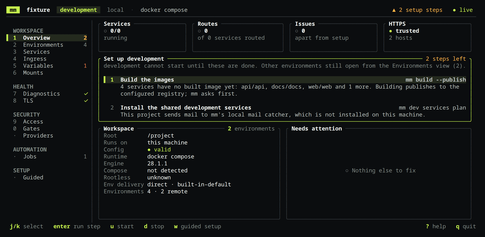

While an environment on this machine cannot start, the Overview shows a
numbered list of what is left, in the order to do it. Each step says what it
changes and names the command that does the same from a shell.

Select a step with `j` and `k` and press `enter` to run it. The terminal UI
steps aside and the step runs in the plain terminal, where it can print, ask
before it changes anything, and prompt for `sudo`. Press any key when it ends
to come back; the list is read again and the finished step is gone. `ctrl+c`
during a step stops it and leaves mm.

| Step                                    | Same as                                    |
| --------------------------------------- | ------------------------------------------ |
| Choose a container runtime              | `mm target preference set-runtime RUNTIME` |
| Set up local HTTPS                      | `mm dev setup`                             |
| Build the images                        | `mm build --publish`                       |
| Install the shared development services | `mm dev services plan`, then `apply`       |

A step marked `after the steps above` needs an earlier one first. A step mm
cannot do for you, such as starting Docker, says what to fix; the list updates
on its own once it is fixed. `mm doctor` prints the same list.

When an environment cannot be read at all, for example because its host does
not answer, the Overview says why and its other views stay empty. mm keeps
checking and shows the environment as soon as it answers.

## Find your way around

The header shows the project, the environment, and where that environment
runs: `local`, or `remote` and the target's name. A remote environment gets a
solid label so it is hard to miss.

Views are listed in the sidebar and numbered. Press the number to open one.

| Key | View         | What it is for                                         |
| --- | ------------ | ------------------------------------------------------ |
| `1` | Overview     | Health at a glance and what needs attention            |
| `2` | Environments | Every environment, where it runs, and switching        |
| `3` | Services     | Services and containers, with their actions            |
| `4` | Ingress      | Routes and why a service has none                      |
| `5` | Variables    | What each service reads and where the value comes from |
| `6` | Mounts       | Development mounts                                     |
| `7` | Diagnostics  | Every finding, with its fix                            |
| `8` | TLS          | The local certificate authority                        |
| `9` | Access       | Who you are on the host, and the team                  |
| `0` | Gates        | Access policies and their users                        |

Providers, Jobs, and Guided have no number: reach them with `tab`, or with `[`
and `]`, which jump between sidebar groups.

## See and switch environments

Press `2`.

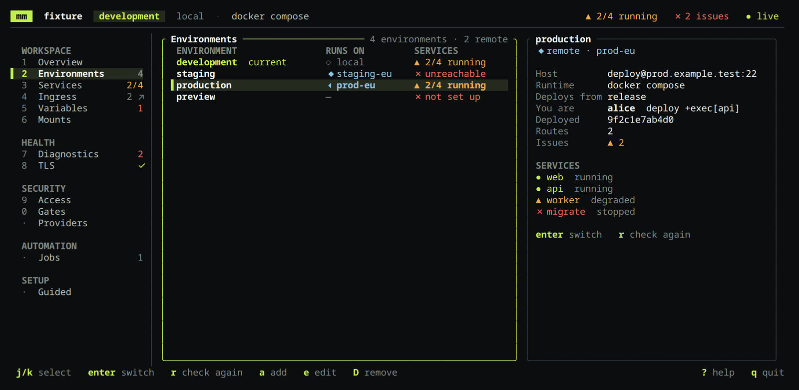

Each row is one environment from the project configuration: where it runs, its
runtime, how many services are running, the deployed commit, and when it was
last checked. The current environment is live. The others are checked when you
open the view; press `r` to check them again. Checking a remote environment
asks its hosts, so the view does not poll them.

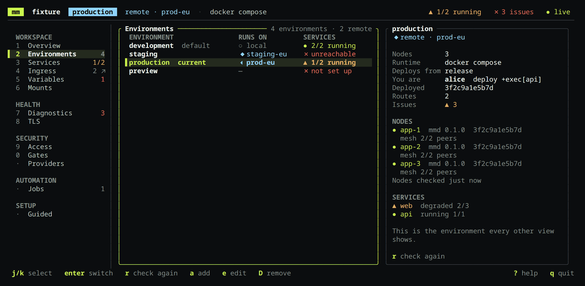

For an environment on a cluster target, the details list every node: its
`mmd` version and deployed commit, its container engine, and how many of
its mesh peers it has a recent handshake with, or what is wrong with it:

```text
● app-1  mmd 0.1.0  3f2c9a1e5b7d  Podman 5.4  mesh 2/2 peers
```

When the target shares volumes, the line also says which node keeps them,
how many a node has mounted, and when a node cannot reach the storage node.
These are the same checks as `mm target nodes`, `mm target mesh status`, and
`mm target storage status`. A node that takes part in a deployment says
`deploying`, and one that holds a rollout nobody finished says
`rollout unfinished`; `mm deploy status` has the details.

The nodes of the current environment are checked like the other
environments: when you open the view, and again with `r`. The line under
them says how old the check is, such as `Nodes checked 40s ago`. Whether a
node answers is live all the same: until the check has answered, a node
reads `answering` and its deployed commit, and a node that stops answering
says why at the next refresh.

The Services view lists
[each service once, with its nodes beneath it](#services-on-a-cluster), and
the Overview shows the release the environment runs: the `deployed:` line of
`mm service status`, or one line for each node when they run different
releases.

A node that stops answering is named in the Services view
(`app-3 not answering`) and counted as an issue in the header, the Overview,
and Diagnostics, with what `mm target nodes` says about it. The services of
the other nodes stay on screen. On a remote environment the Overview's last
card shows how many nodes answer (a cluster) or the deployed commit (one
host); local HTTPS and the shared development services belong to this
machine and are not counted as issues of a remote environment.

Select an environment and press `enter` to switch to it. Every other view then
shows that environment. If the host cannot be reached, the terminal UI says why
and stays where it was. `esc` cancels a switch in progress.

An environment marked `not set up` has no runtime chosen on this machine, or
names a target this machine does not know. Press `enter` to open it and see
what it needs. For an unknown target, register it or use the repository's
target definition, then press `r`.

## Act on a service or a container

Press `3`. Services with more than one container list them underneath; `space`
folds and unfolds the selected service.

The state and the count under `REPLICAS` read as the `STATE` column of
[`mm service status`](./runtime-observability.md#check-services): the count is
the containers that are ready out of how many the service should have, and
`starting` means every container runs and a health check has not passed yet.

Select a service or one of its containers and press `enter` for its actions,
or use the action's key directly.

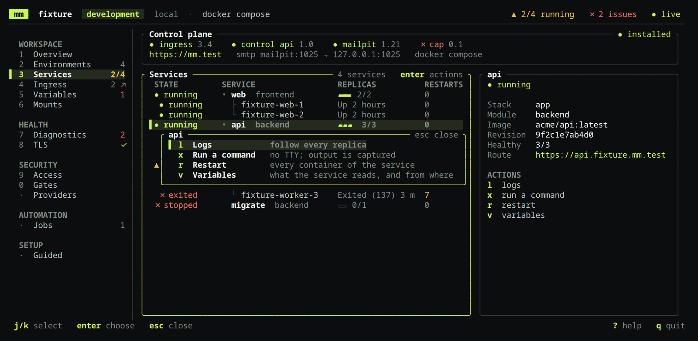

| Key | Action        | On a service                | On a container |
| --- | ------------- | --------------------------- | -------------- |
| `l` | Logs          | Every container             | That container |
| `x` | Run a command | Its first running container | That container |
| `r` | Restart       | Every container             | That container |
| `v` | Variables     | The service's variables     | The same       |

### Optional units

In the development environment, the modules, services, and jobs with
[`development: optional`](./reference/configuration.md#optional-in-development)
that are off on this machine are listed below the services, greyed out as
`off locally`. Press `o` on one to turn it on, or on a running service of an
optional unit to turn that unit off. `o` changes what `mm dev enable` and
`mm dev disable` change; press `u` afterwards to review and apply the
deployment that starts or stops it.

### Services on a cluster

On a cluster target a service is listed once. Beneath it is a muted row for
each node it is placed on, with the node, the container, its health, and its
status in the words of
[`mm service status`](./runtime-observability.md#check-services), or
`no container`, `not answered yet` while the node is being asked, or
`no answer` for a node that did not answer. A row stays muted while its
container runs and is healthy.
A service with one container on one node shows the node after its name and
has no rows beneath it. `space` folds and unfolds the rows.

A node's row is a row to act on, like a container on one host: `l` follows
the log of that node's container, as `mm service logs --node` does, and `x`
runs a command in it. On the service's own row, `x` runs the command where
`mm service exec` runs it: on the first node the service is placed on.

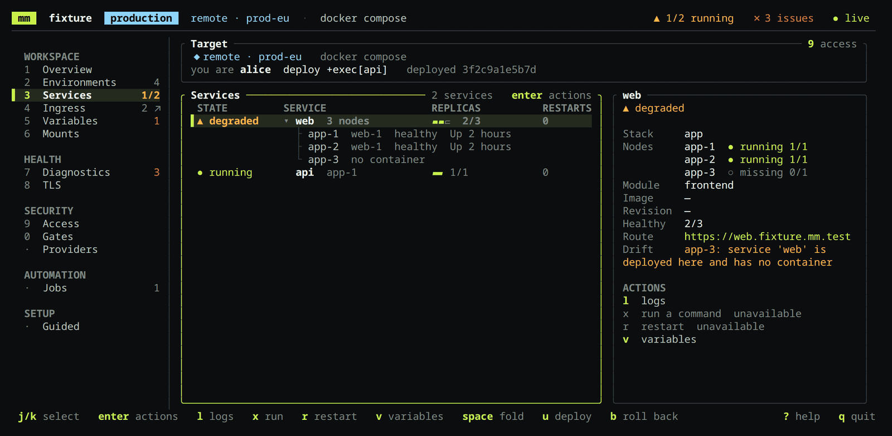

A service's details list the nodes it runs on with its state on each, what
differs on a node from its last deployment, and what its name resolves to on
each network.

### Follow logs

`l` opens the last 200 lines and follows new ones.

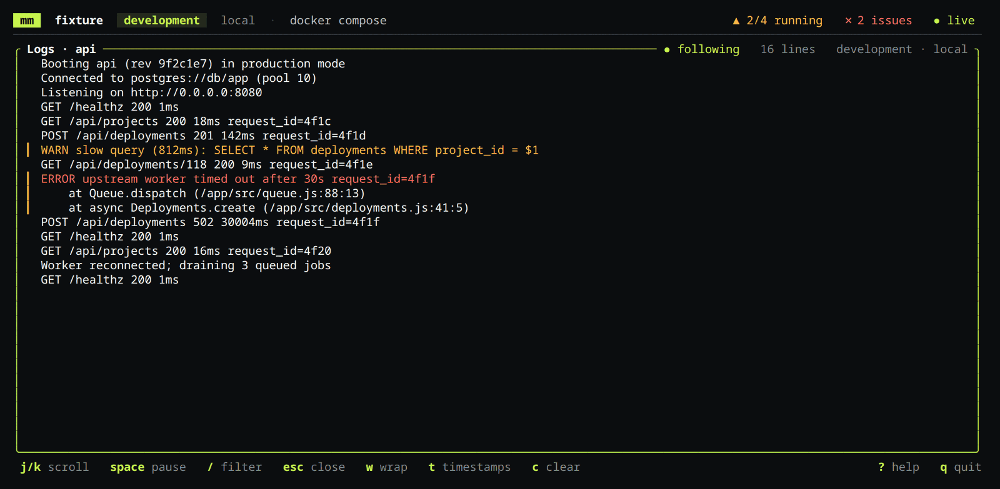

| Key                            | Effect                                             |
| ------------------------------ | -------------------------------------------------- |
| `j` `k`, arrows, `pgup` `pgdn` | Scroll. Scrolling up pauses; new lines are counted |
| `space`                        | Pause, or return to the newest line                |
| `/`                            | Show only lines that contain the text you type     |
| `w`                            | Wrap long lines, or cut them at the edge           |
| `t`                            | Show the time of each line                         |
| `c`                            | Clear the lines shown so far                       |
| `r`                            | Connect again after the stream ended               |
| `esc`                          | Close                                              |

A service with several containers, or on several nodes, is followed as one
stream in time order. Each line starts with its node and container, as in
[`mm service logs`](./runtime-observability.md#read-logs), and every node has
its own colour. The title says how many nodes the lines are merged from. A
node that does not answer is one marked line in the stream, and the lines of
the other nodes keep coming.

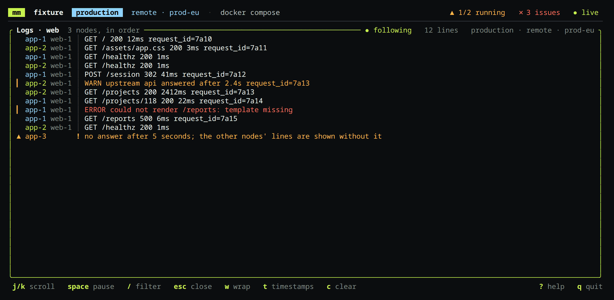

Lines from standard error have a bar in the margin. Lines that mention an
error or a warning are tinted. The environment's secret values are redacted,
as in
[`mm service logs`](./runtime-observability.md#secret-values-are-replaced).
The view keeps the newest 5,000 lines.

### Run a command

`x` asks for a command and runs it in one container.

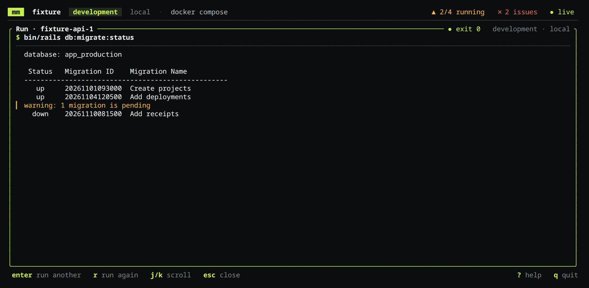

The arguments are passed exactly as typed: no shell runs and there is no TTY.
Quotes group words. For pipes, redirects, or variables, start a shell
yourself:

```text
sh -c 'ls /app | wc -l'
```

The up and down arrows recall earlier commands. A command may run for 30
seconds, the same limit as `mm service exec`; `esc` stops it sooner. When it ends, `enter` asks for another and `r` runs
the same one again. Commands that need input, such as a shell or a database
console, need [`mm service shell`](./runtime-observability.md#run-a-command)
instead.

### Restart

`r` asks first, then restarts the containers. The image, configuration, and
volumes stay as deployed; to pick up a changed variable or image, press `u` to
deploy instead. On a remote environment it needs the `operate` level; on a
cluster a service restarts on one node at a time, as
[`mm service restart`](./runtime-observability.md#restart-a-service) does.

## Change the configuration

Environments, jobs, schedules, configuration values, and the team can be
changed without leaving the terminal UI. The keys are the same in every view
that supports them:

| Key | Effect                   |
| --- | ------------------------ |
| `a` | Add                      |
| `e` | Edit the selected item   |
| `D` | Remove the selected item |

Each change follows the same three steps as
[`mm config`](./concepts/plans-and-apply.md):

1. Fill in a short form. `tab` moves between fields and the arrow keys change
   a choice. An edit keeps every key the form does not show.
2. Review the exact diff of the configuration file. Nothing is written before
   this point; `b` goes back to the form.
3. `enter` writes the file. If your review is out of date because the file
   changed meanwhile, mm refuses and asks you to review again.

A change is a change to files in your checkout. On a remote environment it
takes effect when you commit, push, and deploy; the terminal UI lists those
steps after it saves.

| View         | What you can change                                      |
| ------------ | -------------------------------------------------------- |
| Environments | Add, edit (target, runtime, deploy branches), and remove |
| Variables    | Set or remove a key's value for the current environment  |
| Jobs         | Add, edit, and remove jobs and schedules                 |
| Access       | Add a teammate, change their level, remove them          |

### Change a variable

Press `5`, or `v` on a service to open its variables. The list on the left
holds the environment's services, each with its number of variables and of
problems; the table shows the variables of the one selected. Press `h` to move
to the list, `j` and `k` to choose a service, and `l` or `enter` to return to
the table.

`/` searches every service, not only the one selected: by name, key, value, or
status (secret values are never searched). Matches in the selected service come
first, then those of the other services, each under its service's name. `p`
shows only the variables with a problem, from every service in the same way.
`esc` clears the search and keeps the variable you were on selected, in its own
service.

| Key     | On a local environment                                                                       | On a remote environment            |
| ------- | -------------------------------------------------------------------------------------------- | ---------------------------------- |
| `enter` | Set a value for this workspace only (a local override), or enter a secret without showing it | Set the value in the configuration |
| `x`     | Remove the local override                                                                    | Not available                      |
| `c`     | Set the value in the configuration, for everyone                                             | The same                           |
| `D`     | Remove the value from the configuration                                                      | The same                           |

After a local change, press `u` to start the stack again with the new value.

## Add a teammate

Access to remote environments is declared in the repository's `users:` key:
who each person is, their public keys, and their level per environment. See
[manage remote access](./remote-access.md) for the levels.

Press `9` for the Access view, then `a`.

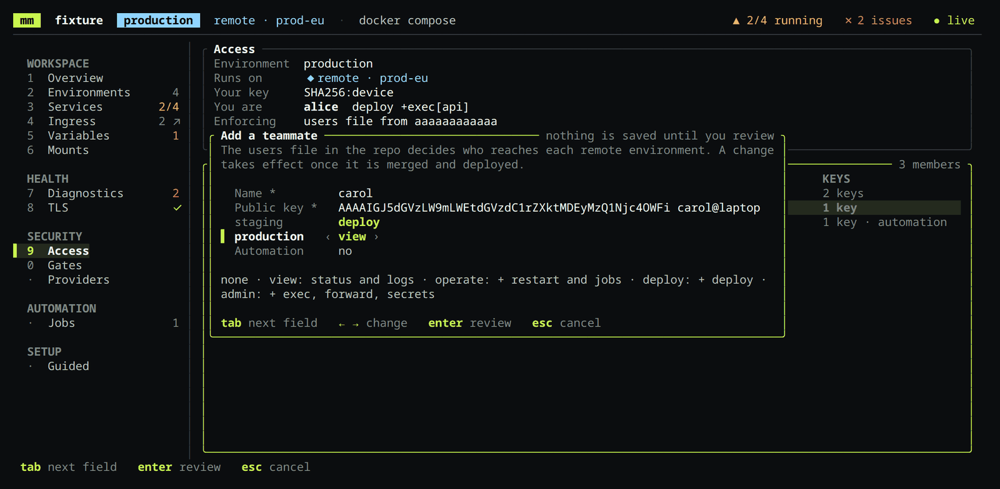

1. Ask your teammate to run `mm key create` and then `mm key show`, and to
   send you the line that starts with `ssh-ed25519`. It is a public key; the
   private half never leaves their machine.
2. Enter their name and paste the key.
3. Choose a level for each remote environment with the arrow keys. `none`
   leaves them out of that environment.
4. Press `enter` and review the diff.

   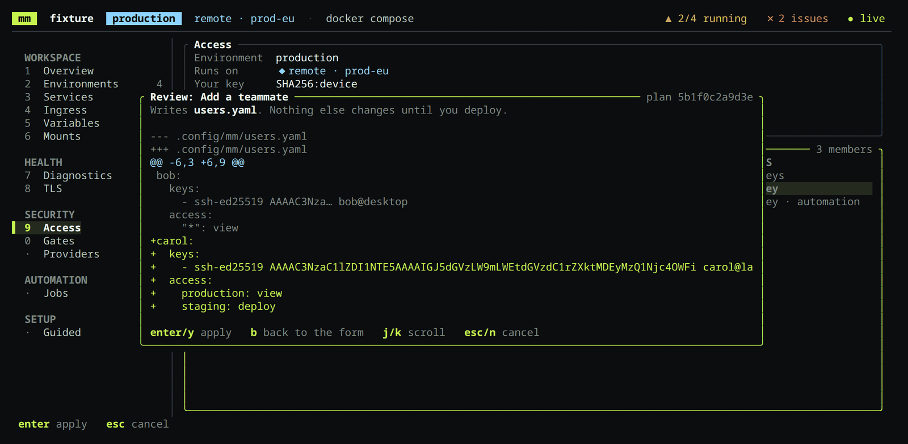

5. Press `enter` again to write the file. The terminal UI then lists what is
   left to do.

   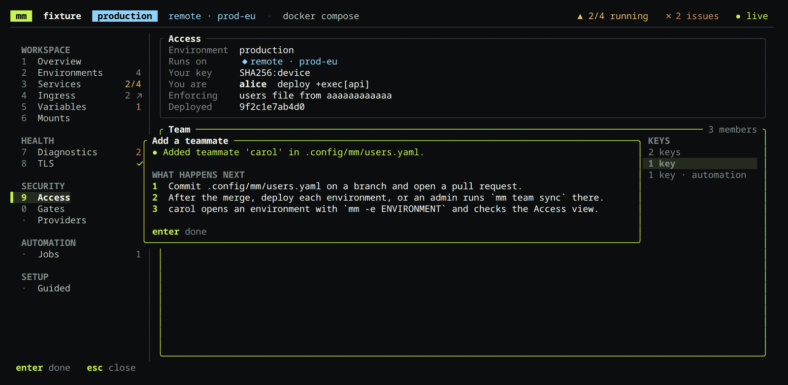

The change gives nobody access by itself. It takes effect when it is merged
and each environment is deployed, or when an admin runs `mm team sync` there.
Who may merge it is up to your repository: move the users into their own file
with `mm config split users` and list `.config/mm/users.yaml` in `CODEOWNERS`
to give access its own reviewers.

To change someone's level, select them and press `e`. To remove them, press
`D`; they keep access to an environment until it is deployed again.

### Request access for yourself

On a new machine, press `9` and then `j`. The terminal UI creates this
device's key if it has none, proposes your entry with the levels you ask for,
and shows the same review. Commit the change on a branch and open a pull
request; a code owner grants the access by merging it.

## Work on a remote environment

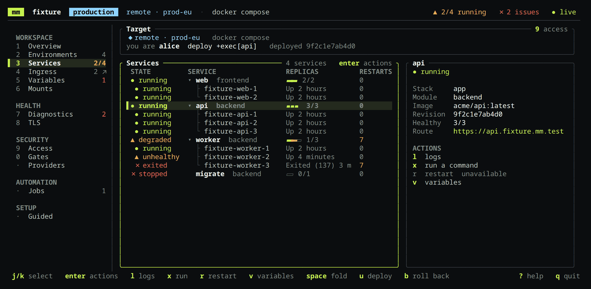

On a remote environment the terminal UI talks to the host's
[remote daemon](./remote-daemon.md) with your device key, and the host decides
what you may do. The Services view shows the target, who the host says you
are, your [access](./remote-access.md), and the deployed commit.

| Action        | On a remote environment                                                                                            |
| ------------- | ------------------------------------------------------------------------------------------------------------------ |
| Status, logs  | Available with `view` access                                                                                       |
| Run a command | Available when the host grants you `exec` for the service                                                          |
| `u`           | Reviews and applies a deploy of your current commit: see [Deploy and roll back](#deploy-and-roll-back)            |
| `b`           | Reviews and applies a rollback, as `mm deploy rollback` does                                                       |
| Restart       | Available with `operate` access; on a cluster one node at a time, each healthy before the next                     |
| Stop          | Not available. Stop the stack on the host                                                                          |
| Variables     | What the hosts hold for each secret and variable, per host. `enter` sets one on every host (hidden input for a secret), `x` stages its removal, `X` drops what is staged; a deployment makes it live. Needs `secrets` access: see [Change an environment's variable](./how-to/change-a-variable.md) |

An error says what the command line says: its code, what happened, and what
to run next, such as
`error[MM_UNREACHABLE]: node 'app-3' did not answer (...). Check that the host is up`.

### Deploy and roll back

Press `u` on the Overview, Services, or Variables view. mm plans a deploy of
your current commit, as `mm deploy plan` does, and shows the plan: what it
starts, on which target and nodes, how many routes, the plan hash, and then
every line `mm deploy plan` prints for it, such as the services that move
between nodes, network changes, shared volumes, the rollout order, what each
hardened service runs with, config files, and the bundle mm sends to a
`delivery: push` target. `j` and `k` scroll it. Nothing changes until you
press `enter`, which applies exactly that plan; `esc` cancels.

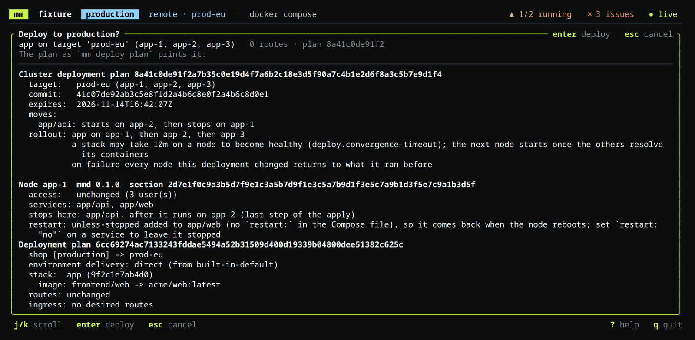

While the plan is applied, each node of a cluster has a row: `waiting`
until its turn, the step it is on (`preparing`, the stack it applies,
`finishing`), the stacks it has applied so far, and `done` or
`runs what it ran before` at the end. The Services view refreshes as each
node finishes a step. `esc` hides the review while the apply goes on; the
header says `Deploying…` and `u` shows the review again. When the apply
ends, the review says how, and `enter` closes it.

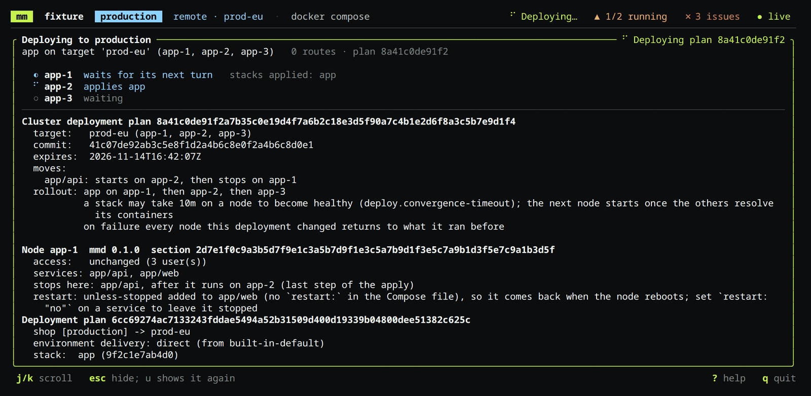

On a remote environment, `b` plans a rollback the same way `mm deploy
rollback` does: it undoes a rollout that was left unfinished, or else the
last finished deployment. The review names what it undoes and the commit the
nodes return to, then shows the plan, and `enter` applies it.

Variables are shown from your checkout. When your checkout differs from the
deployed commit, the view says so instead of showing values the host does not
use.
